  

I build **AI agents that break down complex tasks, retrieve the right evidence, and call the right tools**. My work spans multi-agent decision support, hybrid retrieval, and context-aware AR learning.

MSc Computer Science (Applied Computing) · Universiti Malaya

## Selected work

### 01 · Multi-agent decision support

Built a LangGraph supervisor that breaks requests into steps and routes them to specialist agents. The agents use ReAct-style tool calls to gather evidence and work through each subtask.

`LangGraph` · `ReAct` · `Python` · `Tool calling`

### 02 · Hybrid knowledge retrieval

Combined BM25 keyword search with pgvector semantic retrieval in Neon. Added a reranking stage to surface the most relevant passages before passing them to the LLM.

`BM25` · `PostgreSQL / pgvector` · `Neon` · `Reranking`

### 03 · Mobile AR English Tutor

A research project that uses the learner’s surroundings as context for spoken English practice. The mobile app combines scene context and learner input to generate dialogue for everyday scenarios, then presents it as text and speech.

`Unity` · `AR Foundation` · `LLM dialogue` · `Text-to-speech`

---

Interested in how agents behave when tools fail, retrieval gets noisy, or a task needs more than one step.
